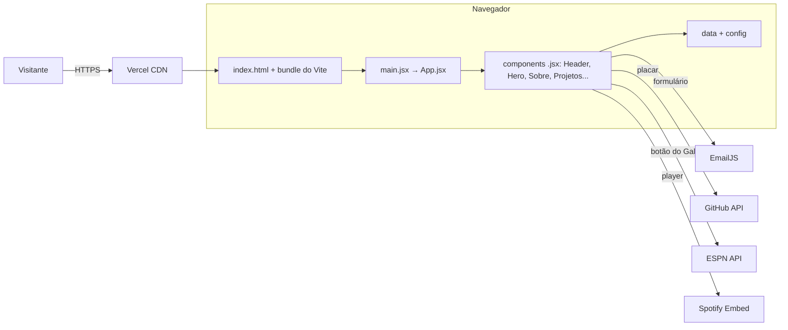
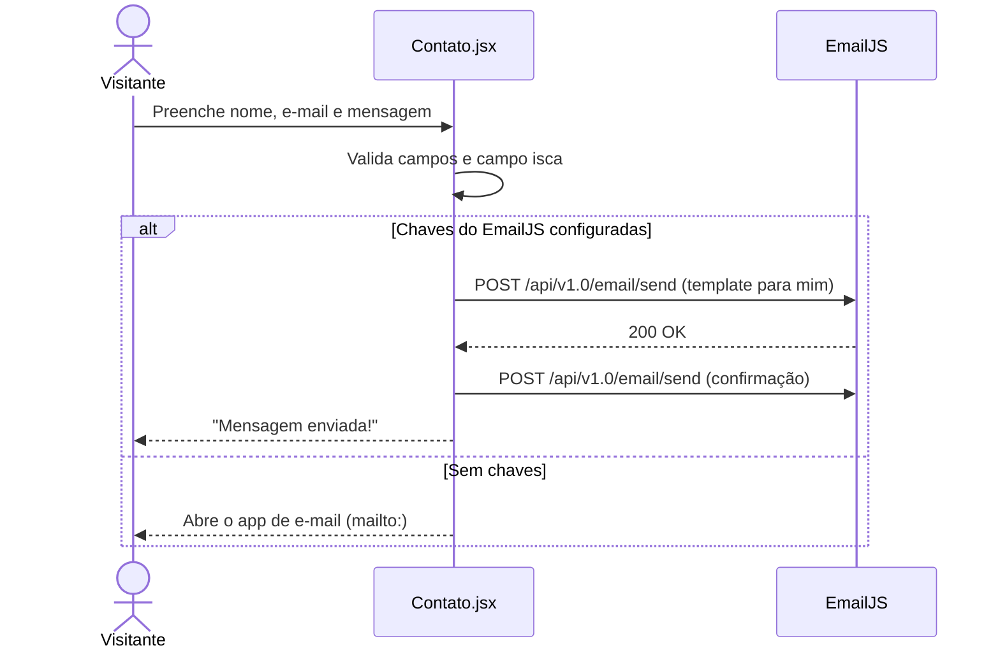

---

# 🕹️ Portfólio Arcade 👨‍💻

> [!NOTE]
> Portfólio profissional bilíngue (PT/EN) com estética de fliperama. **Reúne em um só link quem eu sou, o que já construí, onde atuei e como falar comigo.**

<table>
  <tr>
    <td width="800px">
      <div align="justify">
        O <b>Portfólio</b> de <b>Francisco de Castro Côrtes Netto</b> foi desenvolvido na atividade da disciplina <i>Desenvolvimento e Integração de Aplicações Web (DIAW)</i> do curso de <b>Engenharia de Software da PUC Minas</b>. Quem visita insere uma ficha, aperta START e conhece as seções <i>Sobre Mim</i>, <i>Projetos</i> (em linha do tempo), <i>Experiências</i> e <i>Contato</i>, com formulário que <b>envia e-mail de verdade</b>, além de extras: <i>placar do GitHub</i>, <i>player do Spotify</i>, um <i>botão do Galo</i> com o calendário do Atlético e o jogo <i>Flappy Plane</i>. O site foi feito em <b>React</b>,usa o <b>Vite</b> como ferramenta de build e está publicado gratuitamente na <b>Vercel</b>.
      </div>
    </td>
    <td>
      <div>
        
      </div>
    </td>
  </tr> 
</table>

---

## 🚧 Status do Projeto

[](https://github.com/chicortes/Portfolio-Profissional/releases)
[](#-licença)
[](https://portfolio-profissional-fracortes.vercel.app)

[](https://github.com/chicortes/Portfolio-Profissional/releases)              

---

## 📚 Índice
- [Links Úteis](#-links-úteis)
- [Sobre o Projeto](#-sobre-o-projeto)
- [Funcionalidades Principais](#-funcionalidades-principais)
- [Tecnologias Utilizadas](#-tecnologias-utilizadas)
- [Arquitetura](#-arquitetura)
  - [Diagramas](#diagramas)
- [Instalação e Execução](#-instalação-e-execução)
  - [Pré-requisitos](#pré-requisitos)
  - [Variáveis de Ambiente](#-variáveis-de-ambiente)
  - [Instalação de Dependências](#-instalação-de-dependências)
  - [Inicialização do Banco de Dados](#-inicialização-do-banco-de-dados)
  - [Como Executar a Aplicação](#-como-executar-a-aplicação)
- [Deploy](#-deploy)
- [Estrutura de Pastas](#-estrutura-de-pastas)
- [Demonstração](#-demonstração)
  - [Aplicação Web](#-aplicação-web)
  - [Exemplo de saída no Terminal](#-exemplo-de-saída-no-terminal)
- [Testes](#-testes)
- [Documentações utilizadas](#-documentações-utilizadas)
- [Autores](#-autores)
- [Contribuição](#-contribuição)
- [Agradecimentos](#-agradecimentos)
- [Licença](#-licença)

---

## 🔗 Links Úteis
* 🌐 **Demo Online:** [Acesse a Aplicação Web](https://portfolio-profissional-fracortes.vercel.app)
  > 💻 **Descrição:** Site em produção, hospedado na Vercel. Use `?lang=en` no fim do endereço para abrir em inglês.
* 📱 **Download Mobile:** Não se aplica.
  > 📱 **Descrição:** O projeto é um site responsivo; no celular ele é acessado pelo navegador.
* 📖 **Documentação:** [Protótipo no Figma](https://height-teal-71934295.figma.site)
  > 📚 **Descrição:** Wireframes de média fidelidade das páginas.

---

## 📝 Sobre o Projeto

- **Por que ele existe:** é a atividade avaliativa do Laboratório 01 de DIAW (PUC Minas), que pede um portfólio profissional publicado na nuvem.
- **Qual problema ele resolve:** substitui o currículo solto em PDF por um único link com minha formação, meus projetos, minhas experiências e meus contatos, em português e inglês.
- **Qual o contexto:** acadêmico, mas pensado para uso real em processos seletivos de estágio.
- **Onde ele pode ser utilizado:** no LinkedIn, no currículo, no perfil do GitHub e em candidaturas.

A ideia foi tratar a carreira como um jogo: cada projeto vira uma **fase** da linha do tempo e cada habilidade, um **atributo** com barra de nível. A intro de fliperama deixa o site fácil de lembrar, sem atrapalhar quem só quer a informação: ela pode ser pulada e o menu leva direto a cada seção.

---

## ✨ Funcionalidades Principais

- 🕹️ **Intro de Fliperama:** gabinete desenhado em CSS com moeda animada, som de ficha e zoom na tela. Pode ser pulada com `Esc`.
- 👤 **Sobre Mim (PT/EN):** apresentação, ficha com formação, área, interesses e objetivo, e atributos de 1 a 5.
- 🗂️ **Linha do Tempo de Projetos:** do mais antigo ao mais recente, com nome, descrição, tecnologias, link do GitHub e imagem ou GIF do projeto funcionando.
- 💼 **Experiências:** tipo, instituição, cargo, período, descrição e tecnologias; as atuais aparecem primeiro.
- 📨 **Contato:** atalhos para e-mail, LinkedIn e GitHub e formulário com envio de e-mail via EmailJS, com confirmação automática para quem escreveu.
- ✅ **Validações:** nome, e-mail e mensagem validados nos dois idiomas, contador de caracteres e campo isca (honeypot) contra robôs.
- 🌐 **Internacionalização (i18n):** troca PT/EN sem recarregar a página; a escolha fica salva no navegador.
- 📊 **Placar do GitHub:** repositórios, estrelas, seguidores, contribuições, sequências, linguagens e calendário de contribuições em pixel art. Se o GitHub não responder, usa os números salvos em `src/data/gitHubSnapshot.js`.
- 🐓 **Botão do Galo:** um galo em pixel art embaixo dos atributos; ao clicar, avisa que sou atleticano e mostra os próximos jogos e o último resultado do Atlético Mineiro.
- 🎵 **Spotify:** player incorporado com link para abrir no Spotify.
- 🛩️ **Flappy Plane:** jogo em canvas no fim do portfólio, com recorde salvo no navegador.
- 📱 **Responsividade e Acessibilidade:** layout de 320 px ao desktop, navegação por teclado, foco visível e respeito a `prefers-reduced-motion`.

---

## 🛠 Tecnologias Utilizadas

### 💻 Front-end

* **Framework/Biblioteca:** React 19 (componentes `.jsx` com o `.css` ao lado, como no portfólio de referência do professor)
* **Linguagem/Superset:** JavaScript (JSX), HTML5 e CSS3
* **Estilização:** CSS puro com variáveis (design tokens), Grid, Flexbox e container queries; fontes Press Start 2P e VT323 (Google Fonts)
* **Gerenciamento de Estado:** hooks do React (`useState`, `useEffect`) e Context API (`LanguageContext` para o idioma, `StartContext` para o "APERTE START") + Web Storage
* **Build Tool:** Vite 7

### 🖥️ Back-end

* **Linguagem/Runtime:** Não se aplica (site estático)
* **Framework:** Não se aplica
* **Banco de Dados:** Não se aplica; o conteúdo fica em `src/data`
* **Serviços externos:** [EmailJS](https://www.emailjs.com/) (envio de e-mail), [GitHub REST API](https://docs.github.com/rest) e [GitHub Contributions API](https://github.com/grubersjoe/github-contributions-api) (placar), API pública da ESPN (calendário do Galo) e Spotify Embed
* **Autenticação:** Não se aplica

### ⚙️ Infraestrutura & DevOps

* **Containerização:** Não se aplica
* **Orquestração:** Não se aplica
* **Cloud:** Vercel (hospedagem gratuita)
* **CI/CD:** Deploy automático da Vercel a cada `git push` na `main`, com Preview Deployment em cada pull request

---

## 🏗 Arquitetura

O site é uma **SPA em React**. O `index.html` só tem a `<div id="root">`; o `src/main.jsx` liga o React a ela e o `src/App.jsx` monta a página: intro, cabeçalho, tela inicial, as seções (criadas a partir de `src/data/sectionsData.js`, cada uma com o seu componente) e o rodapé.

- **Componentes (`src/components`):** cada um é um `.jsx` com o `.css` ao lado, no mesmo padrão do portfólio do professor (`Contato.jsx` + `Contato.css`).
- **Contextos (`src/context`):** `LanguageContext` (idioma PT/EN) e `StartContext` (seções liberadas depois do START), compartilhados por todos os componentes.
- **Dados (`src/data`):** textos e listas (sobre, atributos, projetos, experiências, seções, placar salvo), separados da lógica.
- **Configuração (`src/config`):** dados pessoais e links (`siteConfig.js`) e chaves do EmailJS lidas das variáveis de ambiente (`emailJsConfig.js`).
- **Bibliotecas (`src/lib`):** funções sem interface usadas por vários componentes: formatação, armazenamento, som e os dados do placar do GitHub.
- **Idioma:** cada componente guarda os próprios textos em `{ pt, en }` e lê o idioma atual com `useLang()`; trocar o idioma faz o React redesenhar os textos.
- **Decisões:** React, por ser o padrão do mercado e do portfólio de referência; Context API em vez de bibliotecas como i18next ou Redux, porque o site só tem dois estados globais; EmailJS em vez de um servidor próprio, para enviar e-mail sem custo.
- **Trade-offs:** a Public Key do EmailJS vai para o navegador (ela é pública por definição do serviço); sem as chaves, o formulário abre o app de e-mail do visitante (`mailto:`). O placar e o calendário do Galo dependem de APIs externas; o placar tem dados salvos de reserva.

### Diagramas

**Visão Geral (Macro)**



**Fluxo do Formulário de Contato**



---

## 🔧 Instalação e Execução

### Pré-requisitos

* **Node.js:** versão 20.19 ou superior (exigida pelo Vite 7)
* **Gerenciador de Pacotes:** npm (vem com o Node.js)
* **Git:** para clonar o repositório

---

### 🔑 Variáveis de Ambiente

#### 1 Back-end

Não se aplica: o projeto não tem back-end próprio.

#### 2 Front-end (Vite)

Copie o `.env.example` para **`.env.local`** na raiz do projeto e preencha. Todas são opcionais: sem elas o site abre normalmente e o formulário usa o `mailto:`.

| Variável | Descrição | Exemplo |
| :--- | :--- | :--- |
| `VITE_EMAILJS_SERVICE_ID` | ID do serviço de e-mail no EmailJS | `service_xxxxxxx` |
| `VITE_EMAILJS_TEMPLATE_ID_FOR_ME` | Template do e-mail que chega para mim | `template_xxxxxxx` |
| `VITE_EMAILJS_TEMPLATE_ID_FOR_SENDER` | Template de confirmação para quem escreveu (opcional) | `template_yyyyyyy` |
| `VITE_EMAILJS_PUBLIC_KEY` | Public Key da conta EmailJS | `sua_public_key_aqui` |

```bash
cp .env.example .env.local
```

> **Obs:** em projetos **Vite**, só as variáveis que começam com `VITE_` chegam ao código do navegador.

Os demais ajustes ficam em arquivos:

| O que mudar | Onde |
| :--- | :--- |
| Nome, período, foto, currículo, links, usuário do GitHub e playlist do Spotify | `src/config/siteConfig.js` |
| Textos do Sobre Mim e ficha (PT e EN) | `src/data/aboutData.js` |
| Atributos (nível de 1 a 5) | `src/data/skillsData.js` |
| Projetos (data `AAAA-MM`, tecnologias, repositório, imagem/GIF) | `src/data/projectsData.js` |
| Experiências (tipo, início e fim `AAAA-MM`; fim vazio = atual) | `src/data/experiencesData.js` |
| Seções, nomes no menu e textos de abertura | `src/data/sectionsData.js` |
| Números salvos do placar do GitHub | `src/data/gitHubSnapshot.js` |

Prints e GIFs dos projetos vão em `public/img/projetos/` e são usados como `"/img/projetos/nome.gif"`.

**Configurando o EmailJS:**

1. Crie uma conta gratuita em [emailjs.com](https://www.emailjs.com/).
2. Em **Email Services**, conecte seu e-mail e anote o **Service ID**.
3. Em **Email Templates**, crie:
   - **Template para mim:** assunto `{{title}}`, *Reply To* `{{email}}` e corpo com `{{name}}`, `{{email}}`, `{{message}}` e `{{time}}`.
   - **Template para quem escreveu (opcional):** *To Email* `{{email}}`, assunto `{{title}}` e uma mensagem de confirmação.
4. Em **Account → General**, copie a **Public Key**.
5. Preencha o `.env.local` (no computador) e as Environment Variables da Vercel (no site publicado).

> [!WARNING]
> A **Public Key** do EmailJS é feita para ficar no navegador. Nunca coloque a *Private Key* no front-end.

#### 3 Variáveis de Ambiente na Vercel

Em **Project Settings > Environment Variables**, crie as mesmas quatro variáveis `VITE_EMAILJS_*` com os valores do EmailJS e faça um novo deploy.

```
VITE_EMAILJS_SERVICE_ID=seu_service_id_aqui
VITE_EMAILJS_TEMPLATE_ID_FOR_ME=seu_template_id_for_me_aqui
VITE_EMAILJS_TEMPLATE_ID_FOR_SENDER=seu_template_id_for_sender_aqui
VITE_EMAILJS_PUBLIC_KEY=sua_public_key_aqui
```

---

### 📦 Instalação de Dependências

1. **Clone o Repositório:**

```bash
git clone https://github.com/chicortes/Portfolio-Profissional.git
cd Portfolio-Profissional
```

#### Front-end

```bash
npm install
```

| Dependência | Tipo | Para quê |
| :--- | :--- | :--- |
| **react** e **react-dom** | dependency | Biblioteca da interface (React 19) |
| **vite** | devDependency | Servidor de desenvolvimento (`npm run dev`), build (`npm run build`) e `npm run preview` |
| **@vitejs/plugin-react** | devDependency | Suporte a JSX e Fast Refresh no Vite |

Os recursos externos carregados pela internet são:

| Recurso | Para quê | Onde |
| :--- | :--- | :--- |
| **Google Fonts** (Press Start 2P e VT323) | Tipografia pixelada | `index.html` |
| **EmailJS REST API** | Envio do formulário | `src/components/Contato.jsx` |
| **GitHub REST API** e **GitHub Contributions API** | Placar do GitHub | `src/components/GitHubStats.jsx` e `src/lib/githubStats.js` |
| **ESPN API** (`site.api.espn.com`) | Calendário do Atlético Mineiro | `src/components/Galo.jsx` |
| **Spotify Embed** | Player | `src/components/Spotify.jsx` |

---

### ⚡ Como Executar a Aplicação

```bash
npm run dev
```
🎨 *O site estará disponível em **http://localhost:5173**.*

Para conferir a versão de produção:

```bash
npm run build
npm run preview
```

---

## 🚀 Deploy

1. **Build do Projeto:** a Vercel roda `npm run build` sozinha e publica a pasta `dist`.

2. **Publicação na Vercel:**
   1. Envie o código para o GitHub.
   2. Em [vercel.com/new](https://vercel.com/new), importe o repositório `Portfolio-Profissional`.
   3. A Vercel reconhece o **Vite** (Build Command `npm run build`, Output Directory `dist`).
   4. Adicione as variáveis `VITE_EMAILJS_*` e clique em **Deploy**.

3. **Atualizações:** cada `git push` na `main` publica uma nova versão automaticamente, e cada pull request ganha um *Preview Deployment*.

---

## 📂 Estrutura de Pastas

```
.
├── README.md                    # 📘 Documentação principal do projeto.
├── LICENSE                      # ⚖️ Licença do projeto.
├── .gitignore                   # 🧹 Ignora node_modules, dist e .env.local.
├── .env.example                 # 🧩 Variáveis de ambiente necessárias (sem valores).
├── index.html                   # 🏠 Página única com a <div id="root"> do React.
├── vite.config.js               # ⚙️ Configuração do Vite com o plugin do React.
├── package.json                 # 📦 Scripts (dev, build, preview) e dependências.
├── package-lock.json            # 🔒 Versões exatas das dependências.
│
├── /public                      # 📂 Arquivos servidos como estão
│   ├── favicon.svg              # 👾 Ícone do site.
│   ├── /img/projetos            # 🖼️ Prints e GIFs dos projetos.
│   └── /cv                      # 📄 Currículos em PDF (opcional).
│
├── /src                         # 📂 Código-fonte
│   ├── main.jsx                 # 🚀 Ponto de entrada: liga o React ao #root.
│   ├── App.jsx                  # 🧩 Monta a página e liga cada seção ao seu componente.
│   ├── App.css                  # 🎨 Estilos globais: cores, fontes, botões e cards.
│   ├── /components              # 🧱 Um .jsx e um .css por parte da página
│   │   ├── Intro.jsx / .css     # 🕹️ Gabinete de fliperama.
│   │   ├── Header.jsx / .css    # 🧭 Menu e troca de idioma.
│   │   ├── Hero.jsx / .css      # 🏠 Tela inicial com o nome e o START.
│   │   ├── Section.jsx / .css   # 📑 Título e abertura de cada seção.
│   │   ├── SobreMim.jsx / .css  # 👤 Sobre mim, ficha e atributos.
│   │   ├── Galo.jsx / .css      # 🐓 Botão do Galo e calendário do Atlético.
│   │   ├── Projetos.jsx / .css  # 🗂️ Linha do tempo de projetos.
│   │   ├── GitHubStats.jsx / .css # 📊 Placar do GitHub.
│   │   ├── Experiencias.jsx / .css # 💼 Experiências.
│   │   ├── Spotify.jsx / .css   # 🎵 Player do Spotify.
│   │   ├── Contato.jsx / .css   # 📨 Atalhos e formulário.
│   │   ├── FlappyPlaneGame.jsx / .css # 🛩️ Jogo.
│   │   ├── Footer.jsx / .css    # 🔻 Rodapé.
│   │   └── PixelArt.jsx         # 👾 Desenha pixel art em SVG.
│   ├── /context
│   │   ├── LanguageContext.jsx  # 🌎 Idioma atual (PT/EN).
│   │   └── StartContext.jsx     # ▶️ Estado do "APERTE START".
│   ├── /config
│   │   ├── siteConfig.js        # 🔧 Nome, links, GitHub e Spotify.
│   │   └── emailJsConfig.js     # ✉️ Chaves do EmailJS (variáveis VITE_*).
│   ├── /data                    # 🗂️ Conteúdo
│   │   ├── sectionsData.js      # 📑 Seções, menu e textos de abertura.
│   │   ├── aboutData.js         # 👤 Sobre mim e ficha (PT/EN).
│   │   ├── skillsData.js        # 📈 Atributos.
│   │   ├── projectsData.js      # 🗂️ Projetos.
│   │   ├── experiencesData.js   # 💼 Experiências.
│   │   └── gitHubSnapshot.js    # 💾 Números salvos do GitHub.
│   └── /lib                     # 🛠️ Funções sem interface
│       ├── format.js            # 🔤 Datas, números e textos.
│       ├── storage.js           # 💾 localStorage/sessionStorage.
│       ├── sound.js             # 🔊 Bipes de 8 bits.
│       └── githubStats.js       # 📊 Busca e cálculo do placar.
│
└── /docs                        # 📚 Documentação
    ├── /wireframes              # ✏️ Wireframes exportados do Figma.
    └── /screenshots             # 📸 Prints e GIFs do site para este README.
```

---

## 🎥 Demonstração

### 🌐 Aplicação Web

| Tela | Captura de Tela |
| :---: | :---: |
| **Intro (Fliperama)** | **Sobre Mim** |
|  |  |
| **Projetos (Linha do Tempo)** | **Experiências** |
|  |  |
| **Placar do GitHub** | **Spotify** |
|  |  |
| **Botão do Galo** | **Flappy Plane** |
|  |  |
| **Contato e Formulário** |
|  |

### 💻 Exemplo de Saída no Terminal

#### 1. Servidor de desenvolvimento

```bash
npm run dev
```

**Saída Esperada:**
```text
  VITE v7.3.7  ready in 312 ms

  ➜  Local:   http://localhost:5173/
  ➜  Network: use --host to expose
```

#### 2. Requisição feita pelo formulário

```json
{
  "service_id": "service_xxxxxxx",
  "template_id": "template_xxxxxxx",
  "user_id": "sua_public_key_aqui",
  "template_params": {
    "name": "Ana Silva",
    "email": "ana@exemplo.com",
    "message": "Olá! Vi seu portfólio e gostaria de conversar.",
    "time": "13/10/2026, 20:41:05",
    "title": "Nova mensagem do portfólio: Ana Silva"
  }
}
```

**Resposta Esperada:** `200 OK`

---

## 🧪 Testes

### Testes Manuais

O projeto não tem testes automatizados. Antes de cada entrega, este roteiro é seguido:

- [ ] `npm run build` termina sem erros.
- [ ] Enviar o formulário vazio mostra os três erros, e eles mudam de idioma junto com o site.
- [ ] Uma mensagem válida chega no meu e-mail e a confirmação chega para quem escreveu.
- [ ] Os atalhos de e-mail, LinkedIn e GitHub abrem o destino certo.
- [ ] Os projetos aparecem do mais antigo ao mais recente, com imagem ou o quadro com o nome.
- [ ] O placar do GitHub aparece (ao vivo ou com os números salvos).
- [ ] O botão do Galo abre a mensagem e o calendário, e fecha no segundo clique.
- [ ] O Flappy Plane começa com clique ou espaço e o recorde continua depois de recarregar.
- [ ] O nome aparece inteiro, sem cortar palavras, em 320 px, 768 px e 1280 px, e não há rolagem lateral.
- [ ] Tudo é alcançável só com teclado (`Tab`, `Enter` e `Esc` na intro).

### Auditoria de Qualidade

Rodar o **Lighthouse** (DevTools → aba Lighthouse) na versão publicada.

*Ferramenta utilizada: Lighthouse (Chrome DevTools).*

---

## 🔗 Documentações utilizadas

* 📖 **Framework/Biblioteca:** [Documentação Oficial do **React**](https://react.dev/reference/react)
* 📖 **HTML, CSS e JavaScript:** [MDN Web Docs](https://developer.mozilla.org/pt-BR/)
* 📖 **Build Tool:** [Guia do **Vite**](https://vite.dev/guide/)
* 📖 **Envio de E-mail:** [REST API do **EmailJS**](https://www.emailjs.com/docs/rest-api/send/)
* 📖 **GitHub:** [GitHub REST API](https://docs.github.com/rest)
* 📖 **Spotify:** [Spotify Embeds](https://developer.spotify.com/documentation/embeds)
* 📖 **Hospedagem:** [Documentação da **Vercel**](https://vercel.com/docs)
* 📖 **Referência:** [Repo Portfólio Terminal (Prof. João Paulo Aramuni)](https://github.com/joaopauloaramuni/joaopauloaramuni-portfolio)

---

## 👥 Autor

| 👤 Nome | 🖼️ Foto | :octocat: GitHub | 💼 LinkedIn | 📤 Gmail |
|---------|----------|-----------------|-------------|-----------|
| Francisco de Castro Côrtes Netto | <div align="center"></div> | <div align="center"><a href="https://github.com/chicortes"></a></div> | <div align="center"><a href="https://www.linkedin.com/in/francisco-netto-aa8497439"></a></div> | <div align="center"><a href="mailto:franettocortes@gmail.com"></a></div> |

---

## 🤝 Contribuição

1.  Faça um `fork` do projeto.
2.  Crie uma branch para sua feature (`git checkout -b feature/minha-feature`).
3.  Commit suas mudanças (`git commit -m 'feat: Adiciona nova funcionalidade X'`). **(Utilize [Conventional Commits](https://www.conventionalcommits.org/en/v1.0.0/))**
4.  Faça o `push` para a branch (`git push origin feature/minha-feature`).
5.  Abra um **Pull Request (PR)**.

---

## 🙏 Agradecimentos

* [**Engenharia de Software PUC Minas**](https://www.instagram.com/engsoftwarepucminas/) - Pelo apoio institucional, estrutura acadêmica e fomento à inovação e boas práticas de engenharia.
* [**Prof. Dr. João Paulo Aramuni**](https://github.com/joaopauloaramuni) - Pela proposta do laboratório e pelos valiosos ensinamentos sobre Desenvolvimento e Integração de Aplicações Web.
---

## 📄 Licença

Este projeto é distribuído sob a **[Licença MIT](./LICENSE)**.

---